<div align="center">


<br>

**An offline-first path from absolute beginner to Python and GIS programming, with belts, a real interpreter in the page, and progress that stays on the machine.**

<br>

[](app/index.html)
[](app/index.html)
[](app/index.html)
[](app/pyodide/NOTICE.txt)
[](app/pyodide/NOTICE.txt)
[](THIRD_PARTY_NOTICES.md)
[](server/)

[](LICENSE)
[](https://github.com/BronXTJ/py-dojo/actions/workflows/pages.yml)
[](docs/architecture.md#progress)
[](docs/architecture.md)
[](docs/architecture.md#accessibility)

[**Live demo**](https://bronxtj.github.io/py-dojo/) ·
[**Download offline release**](https://github.com/BronXTJ/py-dojo/releases/latest) ·
[**Start here**](docs/START_HERE.md) ·
[**Docs**](docs/README.md)

</div>

---

<div align="center">
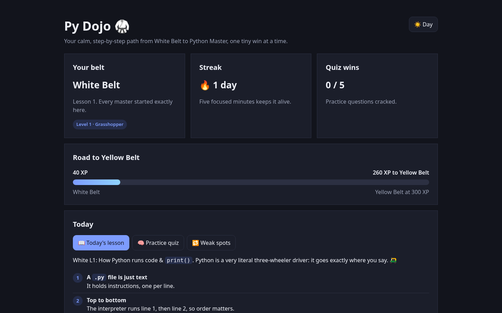
<br>
<sub>Home, dark theme, 1440 × 900. The same screen at tablet and phone size is in <a href="#-screenshots">Screenshots</a>.</sub>
</div>

---

## Contents

- [Why Py Dojo](#-why-py-dojo)
- [Highlights](#-highlights)
- [Screenshots](#-screenshots)
- [How it works](#-how-it-works)
- [Architecture](#-architecture)
- [Curriculum and belts](#-curriculum-and-belts)
- [Getting started](#-getting-started)
- [Testing](#-testing)
- [Repository layout](#-repository-layout)
- [Documentation](#-documentation)
- [Limitations](#-limitations)
- [Citation](#-citation)
- [Acknowledgements](#-acknowledgements)

---

## 🧭 Why Py Dojo

Learning Python for GIS usually means a tutorial in one tab, an interpreter in another, and an error message that disappears when the laptop closes. Py Dojo keeps the path, the interpreter, and the reference on a single page.

1. **Follow a belt** from White to Master. Each belt has a GIS thread, not a separate course waiting at the end.
2. **Run real Python** in the page. The playground checks output, then offers the next hint, and only then the solution.
3. **Keep the progress.** On your computer a small helper writes a JSON file. On the public site the same page uses the browser. There is no account.

> [!IMPORTANT]
> The public site at <https://bronxtj.github.io/py-dojo/> is published by GitHub Actions from the `app/` directory. The repository owner has to set **Settings → Pages → Source** to **GitHub Actions** once. The workflow cannot flip that switch. Until it is set, the live-demo link has nowhere to go.

---

## ✨ Highlights

| | Feature | What it means |
|---|---|---|
| 🥋 | **Ten belts, White to Master** | 119 topics are mapped. White Belt's 15 lessons are built and can be reviewed. Later belts show their map and stay locked until the XP line is reached. |
| ⭐ | **XP and a streak** | First-time scores: practice quiz +10, a glossary word +5, Spot the error +5, a playground pass +15. The streak counts consecutive days the profile was opened. |
| 🐍 | **Python in the browser** | Pyodide 0.26.4 runs CPython 3.12.1 in a Web Worker, from a file shipped with the app. A run longer than 5 seconds is stopped. |
| ✅ | **Checked exercises** | 45 lesson templates, 9 playground templates, 14 Spot-the-error templates, and 5 fixed quiz questions. Hints are stepped. |
| ⚠️ | **Error encyclopedia** | 34 messages captured from CPython 3.13.5 (31 exceptions and 3 surprises that are not errors), plus 9 notes for later belts. The full list is 43 cards. |
| 📖 | **Glossary, 204 terms** | Word of the Day walks one term per day. 173 terms include a code sample whose output was captured. 108 include a GIS note. |
| 🗺️ | **GIS in every belt** | Coordinates and labels at White Belt, through GeoJSON-shaped data, haversine distance, and a Master-belt capstone list (Shapely, GeoPandas, rasterio, PostGIS, folium, scikit-learn). Those libraries are named in the curriculum. They are not installed in the playground. |
| 🔁 | **Review** | A finished White Belt topic can be opened again. Misses land in Weak spots. |
| 💾 | **Progress on the machine** | The Go helper writes `data/<profile>.json`. Pages and a direct file open use the browser. Export and import move a JSON file. |
| 🌗 | **Dark by default** | A day/night control. The choice is stored locally. |
| 📱 | **Phone, tablet, laptop** | Screenshots at 375 × 812, 820 × 1180, and 1440 × 900. |
| ♿ | **Accessibility, as an intention** | Keyboard focus, 44 pixel targets, named controls, a live save line, and reduced motion. Aimed at WCAG AA. Not a formal audit. |

---

## 🖼️ Screenshots

<table>
  <tr>
    <td width="50%">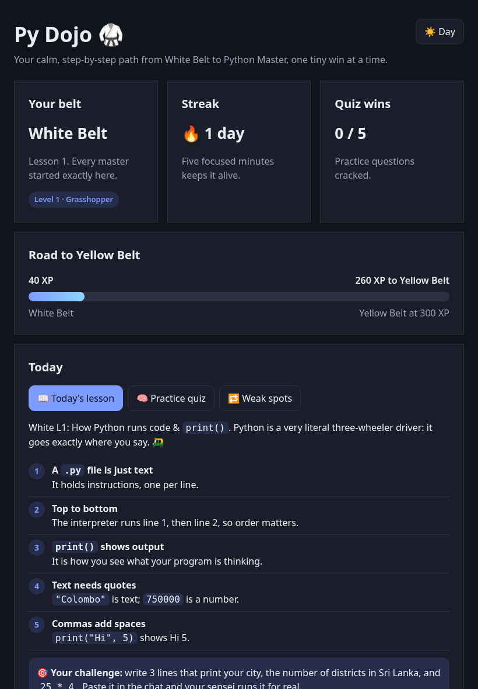<br><sub><b>Tablet, 820 × 1180.</b> Progress cards in a row, then the lesson.</sub></td>
    <td width="50%">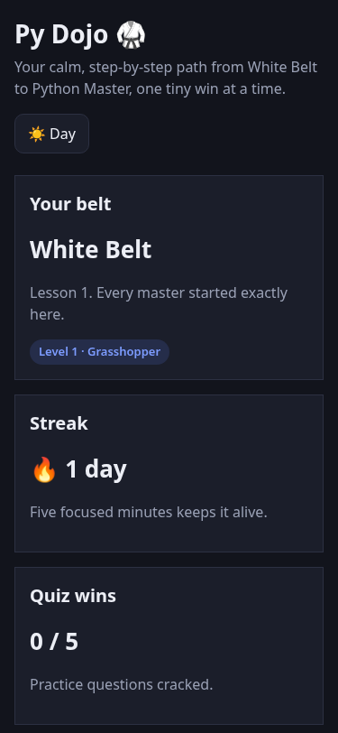<br><sub><b>Phone, 375 × 812.</b> The same home in one column.</sub></td>
  </tr>
  <tr>
    <td>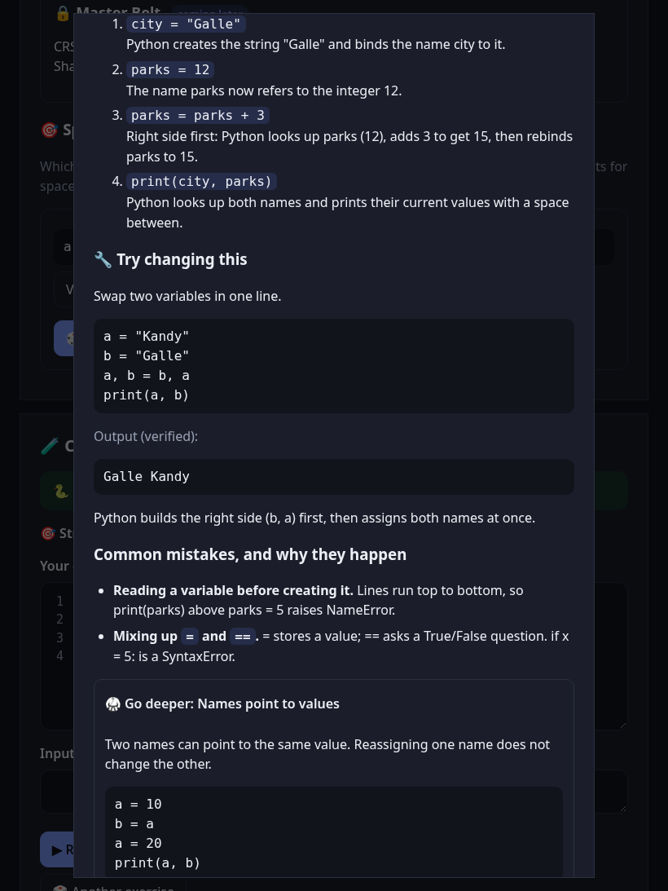<br><sub><b>Lesson.</b> A White Belt topic opened to study again.</sub></td>
    <td>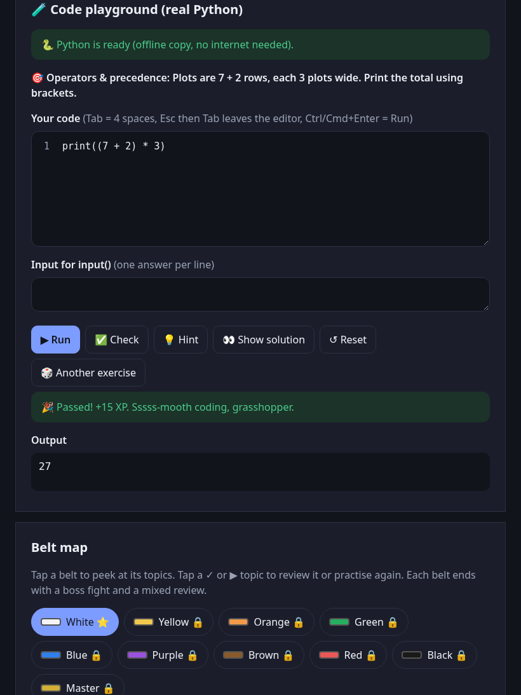<br><sub><b>Playground.</b> Real Python, Run, Check, and hints.</sub></td>
  </tr>
  <tr>
    <td>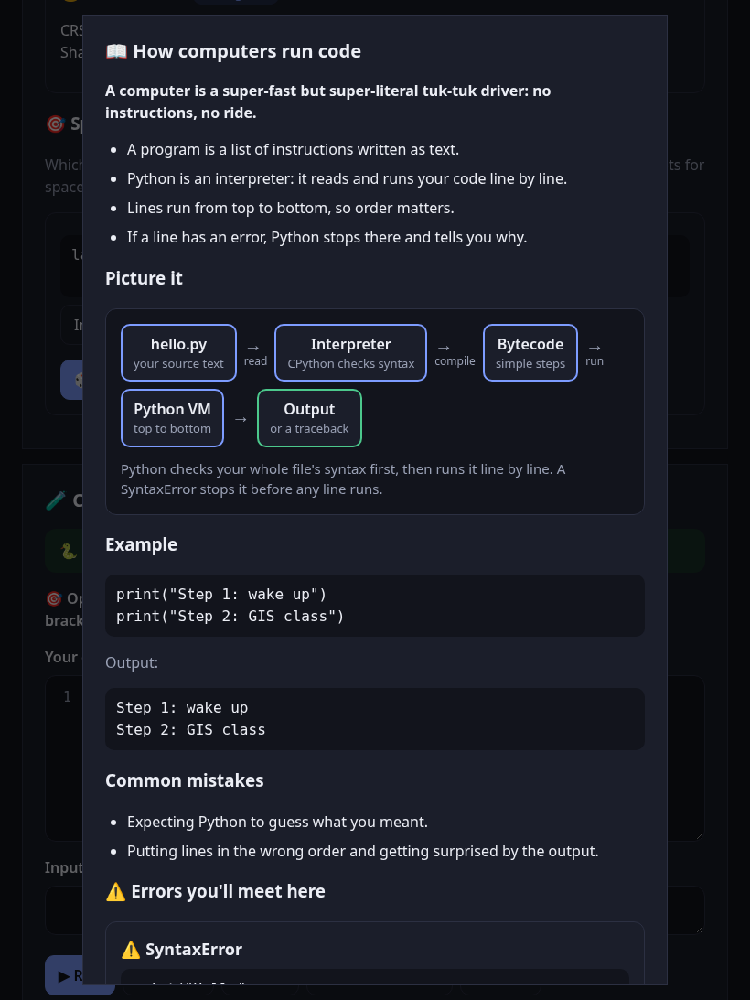<br><sub><b>Diagram.</b> Drawn in the page so it follows the theme.</sub></td>
    <td>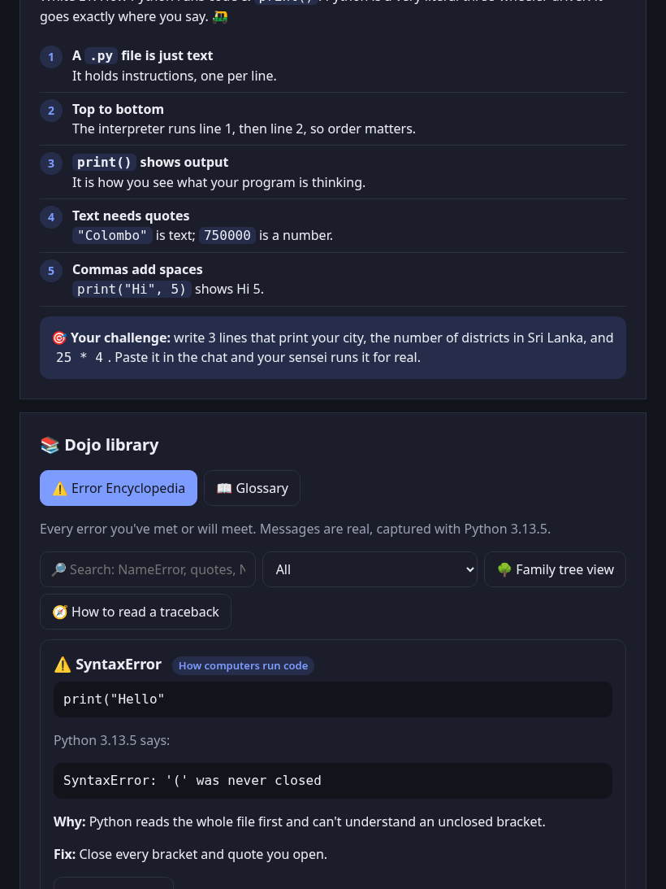<br><sub><b>Error encyclopedia.</b> Messages captured from Python, plus Spot the error.</sub></td>
  </tr>
  <tr>
    <td>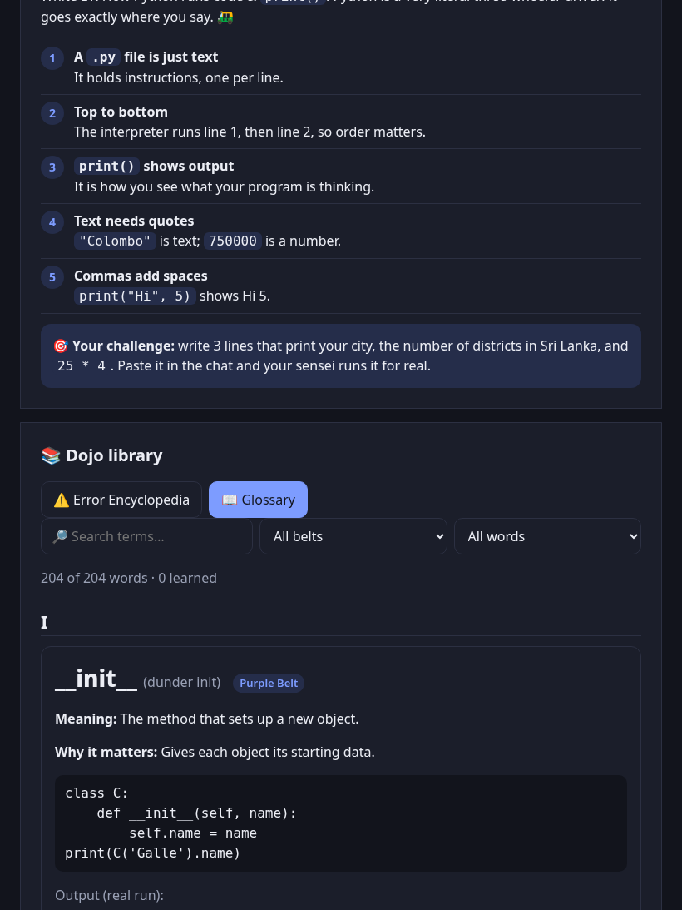<br><sub><b>Glossary.</b> 204 terms, filterable by belt.</sub></td>
    <td>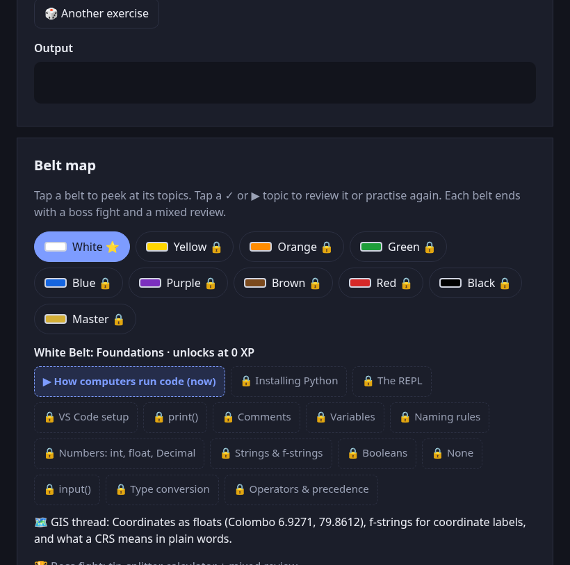<br><sub><b>Belt map.</b> White through Master, with the topics of the selected belt.</sub></td>
  </tr>
</table>

---

## 🔁 How it works

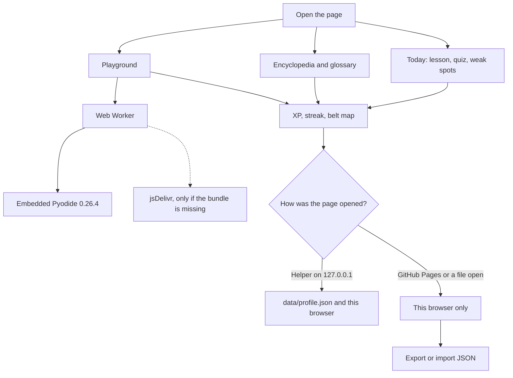

The helper is optional. The lessons and the interpreter do not need it. It exists so a folder you keep can hold the progress file next to the app.

> [!NOTE]
> On GitHub Pages the save line refers to this browser. The helper, which writes `data/<profile>.json`, runs only on the computer where you started it. Export is how a Pages profile moves into that folder.

A day on the streak is a calendar day the profile was opened. The card encourages five focused minutes; the counter itself records the visit. Word of the Day advances one glossary term per UTC day from the day the profile started, then wraps after 204 terms.

---

## 🏗️ Architecture

| Layer | Technology | Responsibility |
|---|---|---|
| Page | HTML, CSS, JavaScript, one file | Lessons, belts, quiz, glossary, encyclopedia, diagrams, profiles, theme |
| Python | Pyodide 0.26.4, CPython 3.12.1, WebAssembly | Playground code in a worker, stopped after 5 seconds |
| Helper | Go 1.21, standard library | Serves the folder on `127.0.0.1`, reads and writes progress JSON |
| Progress | JSON | `localStorage` always; `data/<profile>.json` when the helper is running |
| Content tools | Python 3 and Node.js | Generate and check lessons, errors, glossary entries, and exercises |
| Public site | GitHub Pages | Static `app/` directory. No helper. |

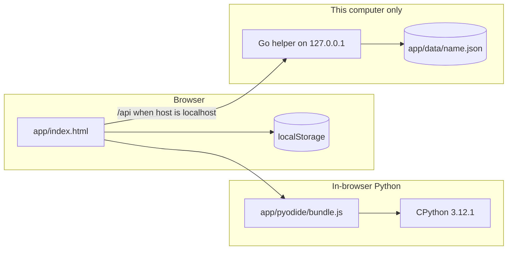

The helper binds `127.0.0.1`, starts at port 8473, and will try through 8482. It refuses a request that is not from loopback. It does not serve the `data/` or `bin/` directories. Profile names are letters, numbers, spaces, hyphens, or underscores, up to 32 characters. A space becomes an underscore in the filename. The body must be valid JSON of at most 1 MiB, written via a temporary file and a rename.

More detail, including the accessibility notes: [`docs/architecture.md`](docs/architecture.md).

---

## 🥋 Curriculum and belts

| Belt | Unlocks at | Theme | Topics | What is in the app |
|---|---:|---|---:|---|
| White | 0 XP | Foundations | 15 | Lessons, exercises, 9 diagrams, playground, captured errors |
| Yellow | 300 XP | Control flow | 9 | Map, glossary, error note |
| Orange | 700 XP | Data structures | 11 | Map, glossary, error note |
| Green | 1,200 XP | Functions and modules | 12 | Map, glossary, error note |
| Blue | 1,800 XP | Robust code | 12 | Map, glossary, error note |
| Purple | 2,500 XP | OOP | 13 | Map, glossary, error note |
| Brown | 3,300 XP | Pythonic and advanced | 11 | Map, glossary, error note |
| Red | 4,200 XP | Testing and quality | 12 | Map, glossary, error note |
| Black | 5,200 XP | Under the hood | 9 | Map, glossary, error note |
| Master | 6,500 XP | Real-world mastery | 15 | Map, glossary, error note |

119 topics. 204 glossary terms across the ten belts. The White Belt GIS thread uses coordinates as floats (Colombo 6.9271, 79.8612), f-strings for labels, and a plain explanation of a CRS. Later belts move through bounding boxes, GeoJSON-shaped dicts, haversine distance, files, classes, streaming, packaging, and the Master capstone.

Every topic name, GIS line, and boss-fight title is in [`docs/curriculum.md`](docs/curriculum.md).

> [!NOTE]
> Reaching a later belt's XP does not invent lessons that are not written yet. The map describes them. The teaching material that can be opened and checked is White Belt.

---

## 🚀 Getting started

### Use it online

Open <https://bronxtj.github.io/py-dojo/> after Pages is set to GitHub Actions, as noted above. Wait for the playground to say Python is ready. Progress stays in that browser. Use **Export progress** at the bottom of the page if you want a file.

### Download an offline release

1. Download `py-dojo-<version>-offline.zip` from [Releases](https://github.com/BronXTJ/py-dojo/releases/latest) and unzip it.
2. Start the helper and leave its window open.
3. The browser opens at <http://localhost:8473/>.

| System | Start file |
|---|---|
| Windows | `Start Py Dojo (Windows).bat` |
| macOS | `Start Py Dojo (Mac).command` |
| Linux | `./start-linux.sh` |

> [!IMPORTANT]
> The zip is built when a `v*.*.*` tag is pushed. It is not in the git tree. Until the first tag is published, Releases has no file. A clone plus Go, below, is the way to run it before that.

**Windows SmartScreen.** The helper is unsigned. If Windows says it protected your PC, choose **More info**, then **Run anyway**. If Firewall asks, **Cancel** is fine: the helper listens only on this computer.

**macOS Gatekeeper.** Right-click the command file, choose **Open**, then **Open** again. If it still refuses:

```bash
xattr -dr com.apple.quarantine "/path/to/the/unzipped/folder"
```

Apple silicon uses `bin/pydojo-mac-arm64`. An Intel Mac uses `bin/pydojo-mac-x64`.

**Linux.**

```bash
chmod +x start-linux.sh
./start-linux.sh
```

If the bundled helper cannot start, the launcher tries Python's `http.server` on port 8473. That serves the page and does not write `data/`. Double-clicking `index.html` is the same idea: the app runs, and progress stays in the browser. Keep the `pyodide` folder beside `index.html`.

### Run from a clone

Git does not contain helper binaries. Build one, or serve the folder.

```bash
git clone https://github.com/BronXTJ/py-dojo.git
cd py-dojo
mkdir -p app/bin
cd server
CGO_ENABLED=0 go build -o ../app/bin/pydojo-linux-x64 .
cd ..
./app/start-linux.sh
```

On macOS or Windows, build the matching name from the table in [`docs/development.md`](docs/development.md) into `app/bin/`, then use that system's Start file.

```bash
# helper binary somewhere else
cd server
CGO_ENABLED=0 go build -o /tmp/pydojo .
PYDOJO_DIR="$PWD/../app" PYDOJO_NO_BROWSER=1 /tmp/pydojo
```

`PYDOJO_NO_BROWSER=1` does not open a browser. Then visit <http://localhost:8473/>.

The longer walkthrough is [`docs/START_HERE.md`](docs/START_HERE.md).

---

## 🧪 Testing

This repository does not ship a unit-test suite, and this section does not quote one. The checks that do exist are content verifiers and a compile of the helper.

From `tools/content-src/`, with Node.js and `python3` on the path:

```bash
node verify.js          # lesson examples and generated questions
node verify_code.js     # playground solutions
node verify_spot.js     # spot-the-error snippets
```

| Script | What a run reported | Stable? |
|---|---|---|
| `verify.js` | 884 Python runs. 0 output mismatches. 18 draws where a multiple-choice question repeated an option (`DUPOPT`), in the floor, modulo, brackets, and power templates. | Yes. The script uses a fixed sample. |
| `verify_code.js` | `problems: 0` | The problem count is the signal. The sample size changes because duplicate random draws are skipped, so it is not quoted here. |
| `verify_spot.js` | `problems: 0` | Same as above. |

Those three commands were run with Python 3.12.3. `verify.js` does not shell out for the duplicate-option findings; they are a property of the templates.

The helper was cross-compiled with `CGO_ENABLED=0` for `linux/amd64`, `darwin/arm64`, `darwin/amd64`, and `windows/amd64`. The Linux binary served the app, hid `/data/` and `/bin/`, rejected a foreign `Host`, and wrote a profile JSON under `app/data/`. The release workflow does the same four builds and packs them into the zip.

The page was also opened the way GitHub Pages will serve it: `app/` mounted at `/py-dojo/` on a hostname that is not `localhost`. The relative `pyodide/bundle.js` loaded, Python reported the offline copy, the save line referred to the browser, and no `/api/` request was made. A phone-width viewport did not overflow horizontally. The only 404 was `favicon.ico`.

For this 0.1.0 tree, the workflow files passed actionlint 1.7.12.

---

## 🗂️ Repository layout

```text
py-dojo/
├── app/                          the site Pages deploys, and the root of the offline zip
│   ├── index.html                the whole app
│   ├── pyodide/
│   │   ├── bundle.js             Pyodide 0.26.4 core, unmodified, about 18 MB
│   │   └── NOTICE.txt
│   ├── data/                     progress JSON appears here at runtime; not committed
│   │   └── README.txt
│   ├── Start Py Dojo (Windows).bat
│   ├── Start Py Dojo (Mac).command
│   ├── start-linux.sh
│   └── README.txt                short guide shipped inside the zip
├── server/                       Go helper source (no committed binary)
│   ├── main.go
│   └── go.mod
├── tools/content-src/            generators and verifiers
├── docs/
│   ├── assets/banner.png
│   ├── screenshots/              dark-theme stills at three sizes, plus feature shots
│   ├── START_HERE.md
│   ├── architecture.md
│   ├── curriculum.md
│   └── development.md
├── .github/
│   ├── workflows/pages.yml       deploy app/ to GitHub Pages
│   ├── workflows/release.yml     cross-compile and attach the offline zip
│   ├── ISSUE_TEMPLATE/
│   └── PULL_REQUEST_TEMPLATE.md
├── LICENSE                       MIT, Copyright (c) 2026 Thanuja Lakshan
├── THIRD_PARTY_NOTICES.md
├── CHANGELOG.md
├── CONTRIBUTING.md
├── CODE_OF_CONDUCT.md
└── CITATION.cff
```

Prebuilt helpers are not in git. They go stale, and the release workflow can build all four from `server/`. The Pyodide bundle stays, because a clone and the Pages site both need it for offline Python, and the file is under GitHub's 100 MB limit.

---

## 📚 Documentation

| | Document | Description |
|---|---|---|
| 🚪 | [`docs/START_HERE.md`](docs/START_HERE.md) | Online, the release zip, and a clone |
| 🏗️ | [`docs/architecture.md`](docs/architecture.md) | Page, worker, helper, progress, accessibility |
| 🥋 | [`docs/curriculum.md`](docs/curriculum.md) | Every belt, topic, GIS line, and boss fight |
| 🛠️ | [`docs/development.md`](docs/development.md) | Regenerating content and building the helper |
| 🤝 | [`CONTRIBUTING.md`](CONTRIBUTING.md) | How to propose a change |
| 📜 | [`CODE_OF_CONDUCT.md`](CODE_OF_CONDUCT.md) | Contributor Covenant 2.1 |
| ⚖️ | [`THIRD_PARTY_NOTICES.md`](THIRD_PARTY_NOTICES.md) | Pyodide (MPL-2.0), CPython, Emscripten, Go |
| 🗒️ | [`CHANGELOG.md`](CHANGELOG.md) | From 0.1.0 |

---

## ⚖️ Limitations

- **White Belt is the taught path.** Yellow through Master are mapped: topics, a GIS line, a boss-fight title, glossary entries, and a one-line error note. Their lessons, playground tasks, and captured tracebacks are not written yet.
- **The playground is the standard library.** Pyodide's core files are embedded. GeoPandas, Shapely, rasterio, NumPy, and the other Master-belt libraries are not.
- **Five-second stop.** A cell that does not finish is halted. That is deliberate.
- **Pages cannot write the progress file.** Progress there is per browser until you export it. There is no account and no sync.
- **One optional network request.** If `pyodide/bundle.js` is missing, the worker loads Pyodide 0.26.4 from jsDelivr. With the file present, Python starts from disk. There is no analytics.
- **Two Python versions.** Encyclopedia text was captured with CPython 3.13.5. The interpreter in the page is CPython 3.12.1. A few messages can differ.
- **Some generated questions repeat an option.** `verify.js` reports 18 such draws in its fixed sample. Output checks in that run did not disagree with Python.
- **The home "Your belt" card** is the starting White Belt presentation in the HTML. The belt map and the XP bar follow saved progress.
- **Release binaries are unsigned.** Windows SmartScreen and macOS Gatekeeper warn the first time. See Getting started.
- **No favicon** is shipped, so a browser will request `/favicon.ico` and get a 404. The app does not need it.

---

## 📝 Citation

If you use this project, please cite it. The machine-readable file is [`CITATION.cff`](CITATION.cff).

```bibtex
@software{pydojo2026,
  author  = {Lakshan, Thanuja},
  title   = {{Py Dojo}: An Offline-First Learning Platform for Python and GIS Programming},
  year    = {2026},
  version = {0.1.0},
  url     = {https://github.com/BronXTJ/py-dojo},
  license = {MIT}
}
```

Original code and lessons are MIT, copyright (c) 2026 Thanuja Lakshan. Pyodide and the other embedded runtimes keep their own licenses. See [THIRD_PARTY_NOTICES.md](THIRD_PARTY_NOTICES.md).

---

## 🙏 Acknowledgements

- [Pyodide](https://github.com/pyodide/pyodide) 0.26.4, Mozilla Public License 2.0, which brings [CPython](https://github.com/python/cpython) 3.12.1 to the browser. The WebAssembly build uses [Emscripten](https://emscripten.org/).
- The [Go](https://go.dev/) standard library, used by the local helper.
- The examples use places in Sri Lanka — Colombo, Kandy, Galle, Jaffna, and others — as the thread that carries GIS ideas from the first belt.

<div align="center">
<br>
<sub>MIT License. Copyright (c) 2026 Thanuja Lakshan.</sub>
</div>
