<div align="center">

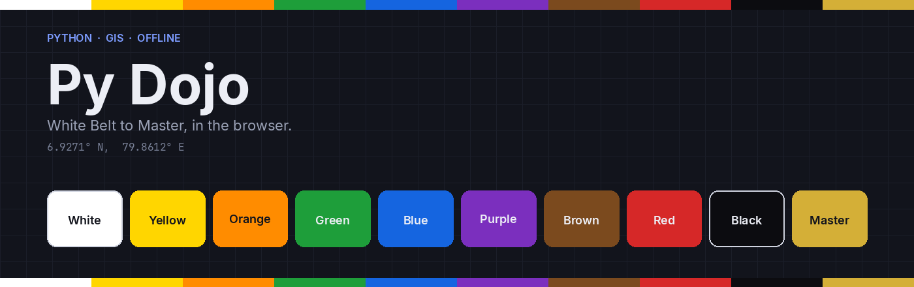

<br>

**An offline-first path from absolute beginner to Python and GIS programming, with belts, a real interpreter in the page, and progress that stays in the browser.**

<br>

[](web/package.json)
[](web/tsconfig.json)
[](web/vite.config.ts)
[](app/pyodide/NOTICE.txt)
[](app/pyodide/NOTICE.txt)
[](THIRD_PARTY_NOTICES.md)
[](server/)

[](LICENSE)
[](https://github.com/BronXTJ/py-dojo/actions/workflows/ci.yml)
[](https://github.com/BronXTJ/py-dojo/actions/workflows/pages.yml)
[](docs/architecture.md#progress)
[](docs/architecture.md)
[](docs/architecture.md#accessibility)

[**Live demo**](https://bronxtj.github.io/py-dojo/) ·
[**Download offline release**](https://github.com/BronXTJ/py-dojo/releases/latest) ·
[**Start here**](docs/START_HERE.md) ·
[**Docs**](docs/README.md)

</div>

---

<div align="center">
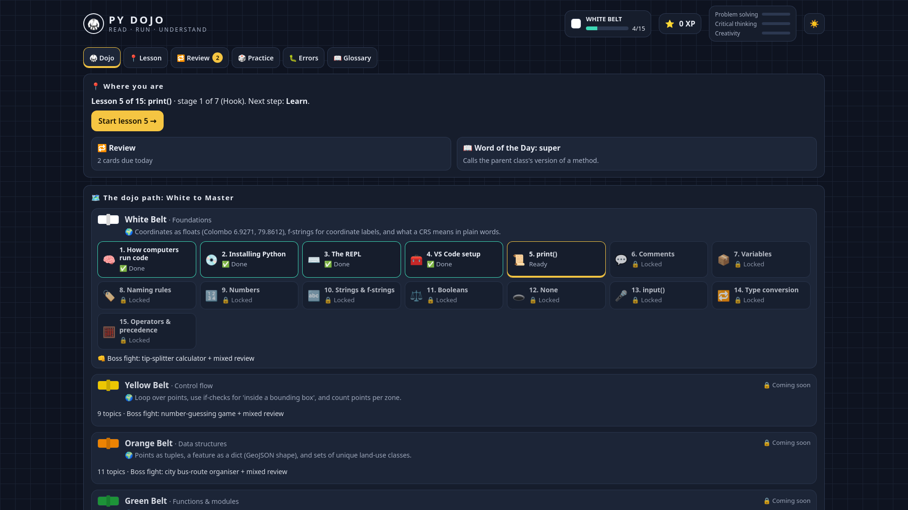
<br>
<sub>Home, dark theme, 1920 × 1080. Phone, tablet, and lesson screens are in <a href="#-screenshots">Screenshots</a>.</sub>
</div>

---

## Contents

- [Why Py Dojo](#-why-py-dojo)
- [Highlights](#-highlights)
- [Screenshots](#-screenshots)
- [How it works](#-how-it-works)
- [Architecture](#-architecture)
- [Curriculum and belts](#-curriculum-and-belts)
- [Getting started](#-getting-started)
- [Testing](#-testing)
- [Repository layout](#-repository-layout)
- [Documentation](#-documentation)
- [Limitations](#-limitations)
- [Citation](#-citation)
- [Acknowledgements](#-acknowledgements)

---

## 🧭 Why Py Dojo

Learning Python for GIS usually means a tutorial in one tab, an interpreter in another, and an error message that disappears when the laptop closes. Py Dojo keeps the path, the interpreter, and the reference on a single page.

1. **Follow a belt** from White to Master. Each belt has a GIS thread, and White Belt is the path you can walk today.
2. **Run real Python** in the page. Watch it, try a Living Lanka task, fix a bug, then take the quiz.
3. **Keep the progress.** The page writes it in the browser. Export makes a JSON file you can move. There is no account.

> [!IMPORTANT]
> The public site at <https://bronxtj.github.io/py-dojo/> is published by GitHub Actions. The workflow builds `web/` with Vite (`base: "./"`) and uploads the built page plus `pyodide/`. The repository owner has to set **Settings → Pages → Source** to **GitHub Actions** once. The workflow cannot flip that switch. Until it is set, the live-demo link has nowhere to go.

---

## ✨ Highlights

| | Feature | What it means |
|---|---|---|
| 🥋 | **Ten belts, White to Master** | 119 topics are mapped in `web/src/content/curriculum.ts`. White Belt's 15 lessons are built. Yellow through Master stay locked, marked coming soon, with their topics and boss fights listed. |
| 🎓 | **Seven stages in every lesson** | Hook, Learn, Watch, Try, Fix the bug, Quiz, and Reward. Watch asks for a prediction and a time-travel scrubber. Try is a Living Lanka task. Reward is the Founder's Challenge. |
| 🐍 | **Python in the browser** | Pyodide 0.26.4 runs CPython 3.12.1 from `pyodide/bundle.js`, in an inline worker. A run longer than 4 seconds is stopped. |
| ⚠️ | **Error encyclopedia** | 43 entries. Search, an exception family tree, and a button that runs the snippet. `ERR_PY` records CPython 3.13.5 as the capture version. |
| 📖 | **Glossary, 204 terms** | Search and a belt filter. Word of the Day is one term per local calendar day, wrapping after 204 terms. |
| 🗺️ | **Living Lanka** | A simplified Sri Lanka outline and city pins in the lesson scene. The outline traces geoBoundaries gbOpen LKA ADM0, CC BY 4.0. |
| 🔁 | **Review** | A Leitner queue fed by quiz answers. Box gaps are 0, 1, 3, 7, 14, and 30 days. |
| 🎲 | **Practice** | Up to five fresh exercises for an unlocked lesson: coding tasks, quiz cards, and spot-the-error. |
| ⭐ | **XP and three meters** | The first time through a stage awards XP. Problem solving, critical thinking, and creativity each sit between 0 and 10. Amounts are listed in [architecture](docs/architecture.md#progress). |
| 💾 | **Progress in the browser** | Autosave under `localStorage` key `pydojo-v2`. Export and Import live on the home screen. |
| 🌗 | **Dark by default** | A day/night control. The choice is part of the saved progress. |
| 📱 | **Phone, tablet, laptop, desktop** | The acceptance suite opens the built page at 390 × 844, 768 × 1024, 1280 × 800, and 1920 × 1080, in dark and light. |
| ♿ | **Accessibility, as an intention** | Keyboard focus, 44 pixel targets, and reduced motion. Aimed at WCAG AA. The Chromium suite checks those three. It is not a formal audit. |

---

## 🖼️ Screenshots

<table>
  <tr>
    <td width="50%">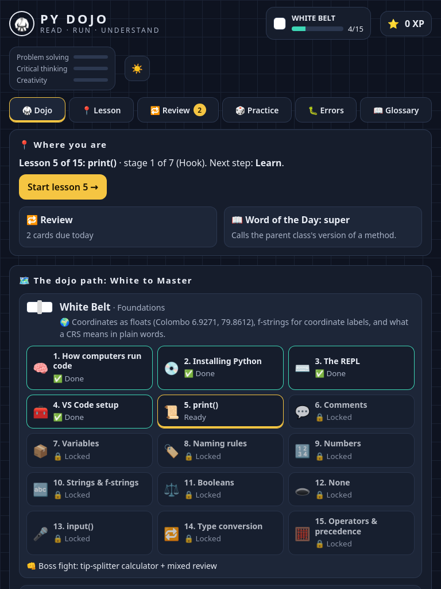<br><sub><b>Tablet, 768 × 1024, dark.</b> Where you are, then the belt path.</sub></td>
    <td width="50%">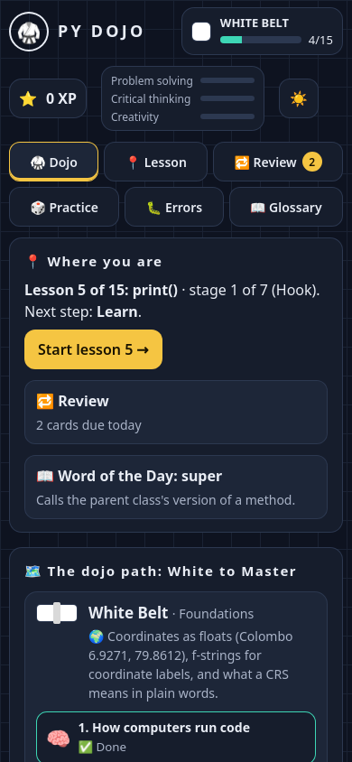<br><sub><b>Phone, 390 × 844, dark.</b> The same home in one column.</sub></td>
  </tr>
  <tr>
    <td>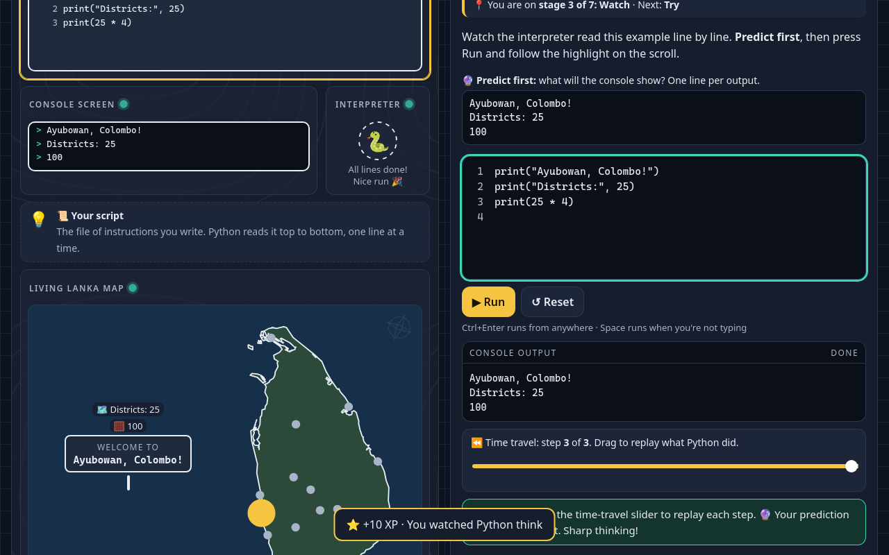<br><sub><b>Watch, 1280 × 800.</b> Predict, then replay the run.</sub></td>
    <td>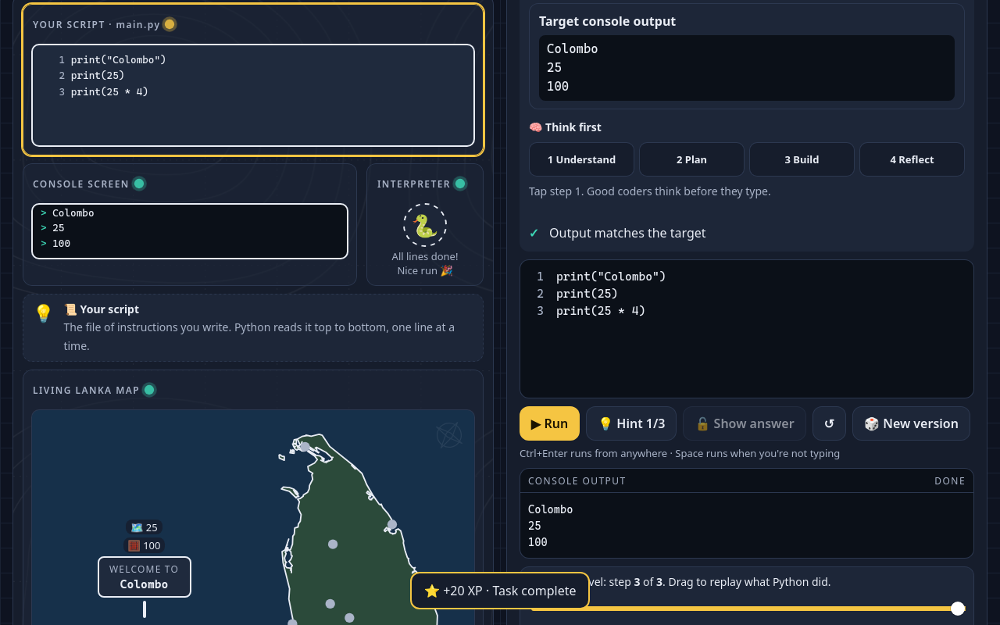<br><sub><b>Try, 1280 × 800.</b> A task whose output has to match.</sub></td>
  </tr>
  <tr>
    <td>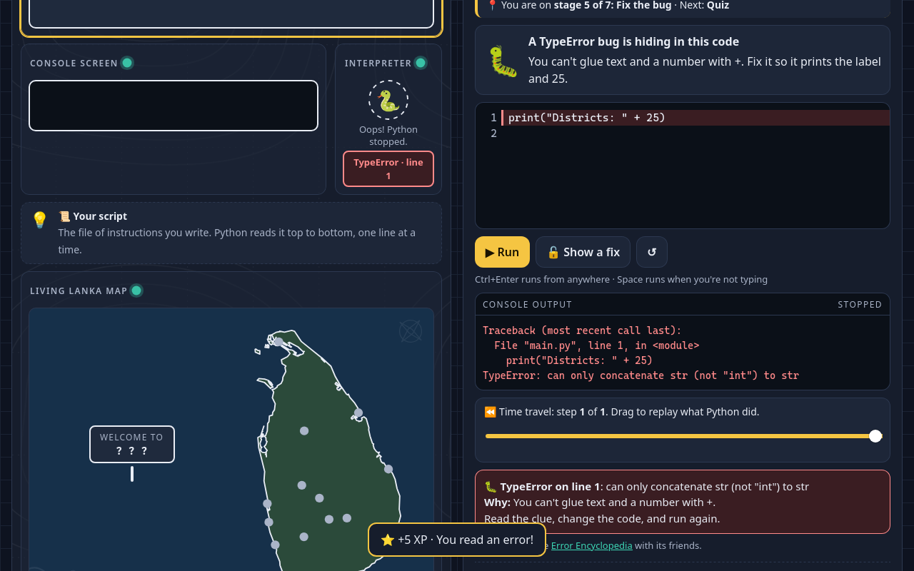<br><sub><b>Fix the bug, 1280 × 800.</b> The broken line is marked, then you repair it.</sub></td>
    <td>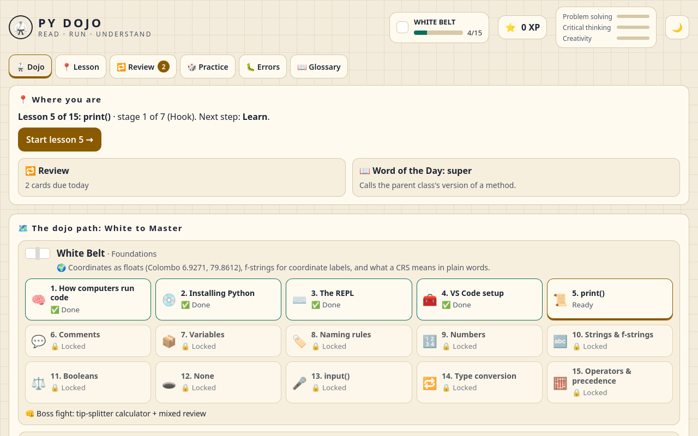<br><sub><b>Home, light theme, 1280 × 800.</b> The same path with the day theme.</sub></td>
  </tr>
  <tr>
    <td>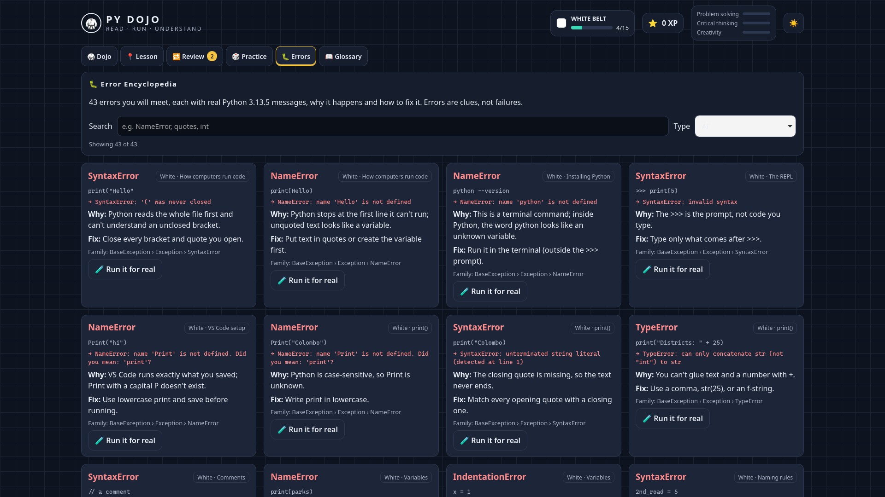<br><sub><b>Error encyclopedia, 1920 × 1080.</b> 43 entries, with search.</sub></td>
    <td>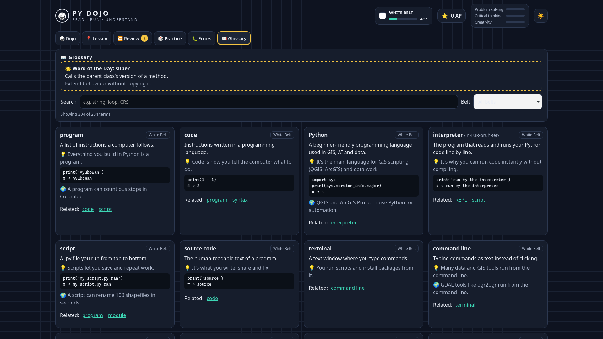<br><sub><b>Glossary, 1920 × 1080.</b> 204 terms and Word of the Day.</sub></td>
  </tr>
  <tr>
    <td>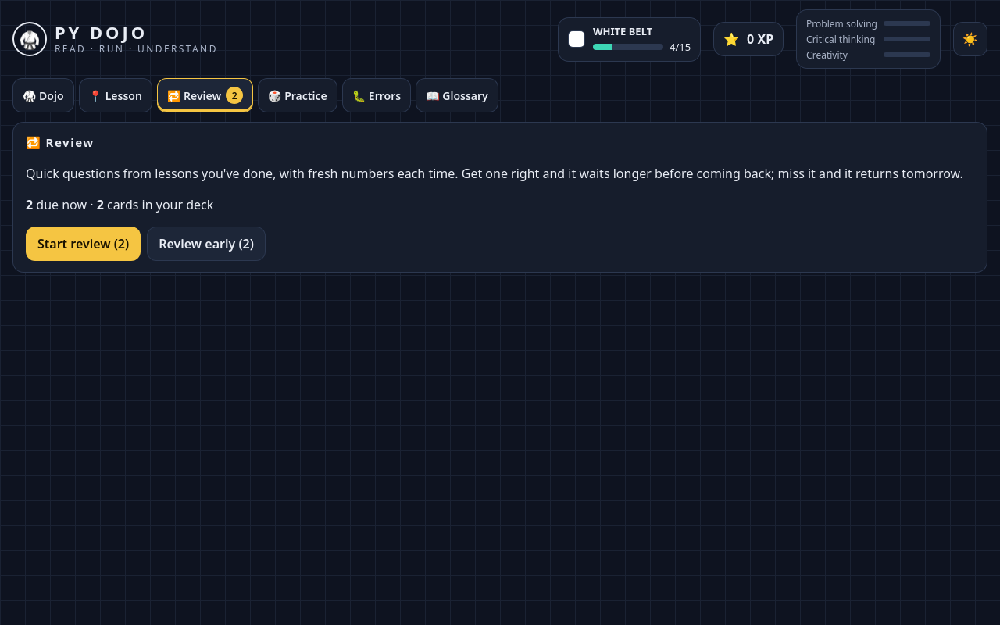<br><sub><b>Review, 1280 × 800.</b> Cards come back on a schedule.</sub></td>
    <td>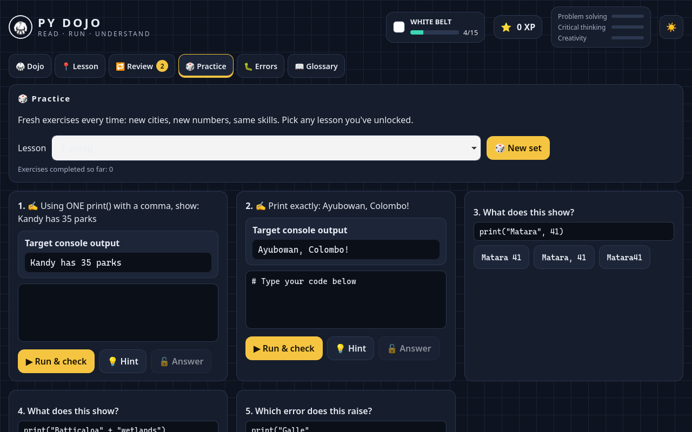<br><sub><b>Practice, 1280 × 800.</b> A fresh set for an unlocked lesson.</sub></td>
  </tr>
</table>

---

## 🔁 How it works

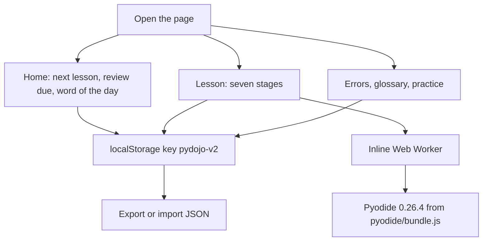

Hash routes (`#/lesson/white-5/2` and the rest) keep the same build working from a `file://` open, from `http://localhost:8473/`, and from GitHub Pages at `/py-dojo/`. Asset URLs in the production build are relative. There is no `<base href>` tag.

The Go helper is optional. It serves the folder on `127.0.0.1`. The React app does not call its `/api/save`, `/api/load`, or `/api/profiles` routes. Progress stays in the browser either way.

> [!NOTE]
> Word of the Day uses the local calendar day: the glossary index is that day number modulo 204. It does not depend on when the profile was created.

---

## 🏗️ Architecture

| Layer | Technology | Responsibility |
|---|---|---|
| App | React 18, TypeScript, Vite, in `web/` | Home, lessons, review, practice, glossary, error encyclopedia, theme |
| Build | Vite 5, `vite-plugin-singlefile`, `base: "./"` | One `index.html` (JS, CSS, and the worker inlined) plus `pyodide/` beside it |
| Python | Pyodide 0.26.4, CPython 3.12.1, WebAssembly | Runs lesson code. Stopped after 4 seconds. Loaded only from `pyodide/bundle.js`. |
| Helper | Go 1.21, standard library (`server/main.go`) | Serves the folder on `127.0.0.1`. Still implements `/api/*` for a client that posts JSON. The UI does not. |
| Progress | JSON in `localStorage` | Key `pydojo-v2`. Export and import on the home screen. |
| Content | TypeScript in `web/src/content/` | Lessons are hand-written. The bank, glossary, errors, and belt table are generated. |
| Public site | GitHub Pages | The Vite `dist/` output, including `pyodide/`. |

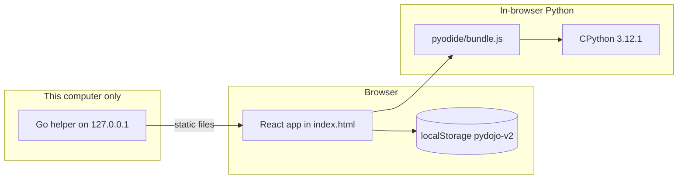

The helper binds `127.0.0.1`, starts at port 8473, and will try through 8482. It refuses a request that is not from loopback. It does not serve `data/` or `bin/`. Profile names, when something uses the API, are letters, numbers, spaces, hyphens, or underscores, up to 32 characters. A save body must be valid JSON of at most 1 MiB, written via a temporary file and a rename.

More detail: [`docs/architecture.md`](docs/architecture.md).

---

## 🥋 Curriculum and belts

| Belt | Unlocks at | Theme | Topics | What is in the app |
|---|---:|---|---:|---|
| White | 0 XP | Foundations | 15 | 15 lessons, seven stages each, captured errors |
| Yellow | 300 XP | Control flow | 9 | Map, glossary, error note |
| Orange | 700 XP | Data structures | 11 | Map, glossary, error note |
| Green | 1,200 XP | Functions and modules | 12 | Map, glossary, error note |
| Blue | 1,800 XP | Robust code | 12 | Map, glossary, error note |
| Purple | 2,500 XP | OOP | 13 | Map, glossary, error note |
| Brown | 3,300 XP | Pythonic and advanced | 11 | Map, glossary, error note |
| Red | 4,200 XP | Testing and quality | 12 | Map, glossary, error note |
| Black | 5,200 XP | Under the hood | 9 | Map, glossary, error note |
| Master | 6,500 XP | Real-world mastery | 15 | Map, glossary, error note |

119 topics. 204 glossary terms across the ten belts (65 of them on White). The White Belt GIS thread uses coordinates as floats (Colombo 6.9271, 79.8612), f-strings for labels, and a plain explanation of a CRS. Later belts move through bounding boxes, GeoJSON-shaped dicts, haversine distance, files, classes, streaming, packaging, and the Master capstone.

Every topic name, GIS line, and boss-fight title is in [`docs/curriculum.md`](docs/curriculum.md).

> [!NOTE]
> Reaching a later belt's XP does not unlock lessons that are not written yet. The home map keeps Yellow through Master locked and labelled coming soon. The teaching material you can open is White Belt.

---

## 🚀 Getting started

### Use it online

Open <https://bronxtj.github.io/py-dojo/> after Pages is set to GitHub Actions, as noted above. Wait until the status line says Python is ready. Progress stays in that browser. Use **Export** on the home screen if you want a file.

### Download an offline release

1. Download `py-dojo-<version>-offline.zip` from [Releases](https://github.com/BronXTJ/py-dojo/releases/latest) and unzip it.
2. Start the helper and leave its window open.
3. The browser opens at <http://localhost:8473/>.

| System | Start file |
|---|---|
| Windows | `Start Py Dojo (Windows).bat` |
| macOS | `Start Py Dojo (Mac).command` |
| Linux | `./start-linux.sh` |

> [!IMPORTANT]
> The zip is built when a `v*.*.*` tag is pushed. It is not in the git tree. Until a tag is published, Releases has no file. A clone, below, is the way to run it before that.

**Windows SmartScreen.** The helper is unsigned. If Windows says it protected your PC, choose **More info**, then **Run anyway**. If Firewall asks, **Cancel** is fine: the helper listens only on this computer.

**macOS Gatekeeper.** Right-click the command file, choose **Open**, then **Open** again. If it still refuses:

```bash
xattr -dr com.apple.quarantine "/path/to/the/unzipped/folder"
```

Apple silicon uses `bin/pydojo-mac-arm64`. An Intel Mac uses `bin/pydojo-mac-x64`.

**Linux.**

```bash
chmod +x start-linux.sh
./start-linux.sh
```

If the bundled helper cannot start, the launcher tries Python's `http.server` on port 8473, then opens `index.html` directly. Keep the `pyodide` folder beside `index.html`.

### Run from a clone

Node.js 22 is what CI uses. Go 1.21 or newer is only needed for the helper.

```bash
git clone https://github.com/BronXTJ/py-dojo.git
cd py-dojo/web
npm ci
npm run dev
```

The dev server reads the Pyodide runtime from `app/pyodide/`. `npm run build` typechecks, writes one `web/dist/index.html`, and copies that runtime to `web/dist/pyodide/`.

To serve the built page with the helper:

```bash
cd server
CGO_ENABLED=0 go build -o /tmp/pydojo .
PYDOJO_DIR="$PWD/../web/dist" PYDOJO_NO_BROWSER=1 /tmp/pydojo
```

Then open <http://localhost:8473/>. `PYDOJO_NO_BROWSER=1` does not open a browser. `PYDOJO_DIR` is the folder that contains `index.html`.

The longer walkthrough is [`docs/START_HERE.md`](docs/START_HERE.md).

---

## 🧪 Testing

From `web/`, with Node.js 22:

```bash
npm ci
npm run typecheck
npm run lint
npm test
npm run build
npm run qa -- chromium
```

| Check | What it covers |
|---|---|
| `npm run typecheck` | `tsc -p tsconfig.json` on `web/src` (strict, `noUncheckedIndexedAccess`) |
| `npm run lint` | ESLint with typescript-eslint strict and the React hooks plugin |
| `npm test` | Vitest. `src/checker.test.ts` asserts 15 lessons, 43 errors, 204 glossary terms, and the 10 belt names, plus checkers, the router, and storage sanitize. |
| `npm run build` | Typecheck, Vite single-file build, copy `app/pyodide` into `dist/pyodide` |
| `npm run qa -- chromium` | Playwright acceptance suite against `dist/index.html`: layout, contrast, and the Living Lanka scene at four sizes in dark and light; a 15-lesson journey; the page served at `/py-dojo/`; reduced motion, keyboard focus, and 44 pixel targets |

`playwright-core` does not download a browser. Chromium uses `CHROME_PATH` (default `/usr/bin/google-chrome`). `CHROME_NO_SANDBOX=1` adds `--no-sandbox` for environments that need it. `PYDOJO_URL` and `PYDOJO_SHOTS` override the page and the screenshot directory. `PYDOJO_ONLY` can be `layout`, `journey`, `base`, or `a11y`.

`npm run verify` runs curriculum snippets in real Pyodide. It is not part of CI. `npm run gen` rewrites `web/src/content` and needs `tools/content-src` plus `/tmp/olddata.json`. It is not part of CI.

The helper compiles with `CGO_ENABLED=0` from `server/`. CI builds the Linux binary. The release workflow cross-compiles `linux/amd64`, `darwin/arm64`, `darwin/amd64`, and `windows/amd64`.

On the machine that prepared 0.2.0, with Node.js 22.23.4 and `/usr/bin/google-chrome`:

| Command | Result |
|---|---|
| `npm run typecheck` | Passed |
| `npm run lint` | Passed |
| `npm test` | 12 tests passed in `src/checker.test.ts` |
| `npm run build` | Wrote `web/dist/index.html` and copied `app/pyodide` into `web/dist/pyodide` |
| `npm run qa -- chromium` | Exited 0. Eight layout cases passed (laptop, phone, iPad, and desktop, in dark and light). The 15-lesson journey passed with 7 stages in each lesson. The page served at `/py-dojo/` passed. Reduced motion, keyboard focus, and 44 pixel targets passed. |

The workflow files passed actionlint 1.7.12. CI on the pull request runs the same web checks and a `gofmt` plus `go build` of `server/`.

---

## 🗂️ Repository layout

```text
py-dojo/
├── web/                          React + TypeScript app (Vite)
│   ├── src/                      screens, stages, content, Pyodide engine
│   ├── tests/qa.cjs              Playwright acceptance suite
│   ├── scripts/copy-pyodide.mjs  copies app/pyodide into dist/ after a build
│   ├── scripts/gen-content.py    regenerates src/content from tools/content-src
│   ├── package.json
│   └── vite.config.ts            base "./", single-file build
├── app/pyodide/                  vendored Pyodide 0.26.4 (MPL-2.0), not built by Vite
│   ├── bundle.js
│   └── NOTICE.txt
├── packaging/                    files copied into the offline zip and the Pages root
│   ├── start-linux.sh
│   ├── Start Py Dojo (Mac).command
│   ├── Start Py Dojo (Windows).bat
│   ├── README.txt
│   ├── .nojekyll
│   └── data/README.txt
├── server/                       Go helper source (no committed binary)
│   ├── main.go
│   └── go.mod
├── tools/content-src/            inputs for gen-content.py, plus the older verifiers
├── docs/
│   ├── assets/banner.png
│   ├── screenshots/
│   ├── START_HERE.md
│   ├── architecture.md
│   ├── curriculum.md
│   └── development.md
├── .github/workflows/
│   ├── ci.yml                    typecheck, lint, vitest, Chromium acceptance, go build
│   ├── pages.yml                 Vite build, upload dist + pyodide
│   └── release.yml               four helper binaries + offline zip
├── LICENSE                       MIT, Copyright (c) 2026 Thanuja Lakshan
├── THIRD_PARTY_NOTICES.md
├── CHANGELOG.md
├── CONTRIBUTING.md
├── CODE_OF_CONDUCT.md
└── CITATION.cff
```

`web/dist/` and `web/node_modules/` are not committed. Pages and the release zip build them. Prebuilt helpers are not in git. The Pyodide bundle stays, because a clone, the dev server, and the Pages site all need it for offline Python, and the file is under GitHub's 100 MB limit.

---

## 📚 Documentation

| | Document | Description |
|---|---|---|
| 🚪 | [`docs/START_HERE.md`](docs/START_HERE.md) | Online, the release zip, and a clone |
| 🏗️ | [`docs/architecture.md`](docs/architecture.md) | React app, worker, helper, progress, accessibility |
| 🥋 | [`docs/curriculum.md`](docs/curriculum.md) | Every belt, topic, GIS line, and boss fight |
| 🛠️ | [`docs/development.md`](docs/development.md) | Build, tests, content regeneration, the helper |
| 🤝 | [`CONTRIBUTING.md`](CONTRIBUTING.md) | How to propose a change |
| 📜 | [`CODE_OF_CONDUCT.md`](CODE_OF_CONDUCT.md) | Contributor Covenant 2.1 |
| ⚖️ | [`THIRD_PARTY_NOTICES.md`](THIRD_PARTY_NOTICES.md) | Pyodide (MPL-2.0), CPython, Emscripten, Go, geoBoundaries |
| 🗒️ | [`CHANGELOG.md`](CHANGELOG.md) | 0.2.0 is the React app. 0.1.0 was the single-file page. |

The package notes for the Vite project itself are in [`web/README.md`](web/README.md).

---

## ⚖️ Limitations

- **White Belt is the taught path.** Yellow through Master are mapped: topics, a GIS line, a boss-fight title, glossary entries, and an error note. Their lessons are not in the app. The belt map says coming soon.
- **The playground is the standard library.** GeoPandas, Shapely, rasterio, NumPy, and the other Master-belt libraries are named in the curriculum. They are not installed.
- **Four-second stop.** A cell that does not finish is halted. That is deliberate.
- **Progress is per browser.** Export and Import are how a copy moves. There is no account and no sync. The helper's save API is still in the binary, and the React UI does not call it.
- **Python starts only from `pyodide/bundle.js`.** If that file is missing, the status line says the files are missing. The page does not fetch Pyodide from a CDN.
- **Two Python versions.** Encyclopedia text was captured with CPython 3.13.5 (`ERR_PY` in `web/src/content/errors.ts`). The interpreter in the page is CPython 3.12.1. A few messages can differ.
- **Release binaries are unsigned.** Windows SmartScreen and macOS Gatekeeper warn the first time. See Getting started.
- **The favicon is an empty data URL** so the page does not request `/favicon.ico`.

---

## 📝 Citation

If you use this project, please cite it. The machine-readable file is [`CITATION.cff`](CITATION.cff).

```bibtex
@software{pydojo2026,
  author  = {Lakshan, Thanuja},
  title   = {{Py Dojo}: An Offline-First Learning Platform for Python and GIS Programming},
  year    = {2026},
  version = {0.2.0},
  url     = {https://github.com/BronXTJ/py-dojo},
  license = {MIT}
}
```

Original code and lessons are MIT, copyright (c) 2026 Thanuja Lakshan. Pyodide and the map outline keep their own licenses. See [THIRD_PARTY_NOTICES.md](THIRD_PARTY_NOTICES.md).

---

## 🙏 Acknowledgements

- [Pyodide](https://github.com/pyodide/pyodide) 0.26.4, Mozilla Public License 2.0, which brings [CPython](https://github.com/python/cpython) 3.12.1 to the browser. The WebAssembly build uses [Emscripten](https://emscripten.org/).
- The [Go](https://go.dev/) standard library, used by the local helper.
- The Sri Lanka outline in the lesson scene is a simplified trace of [geoBoundaries](https://www.geoboundaries.org/) gbOpen LKA ADM0, [CC BY 4.0](https://creativecommons.org/licenses/by/4.0/). Runfola, D. et al. (2020) geoBoundaries: A global database of political administrative boundaries. PLoS ONE 15(4): e0231866. <https://doi.org/10.1371/journal.pone.0231866>
- The examples use places in Sri Lanka — Colombo, Kandy, Galle, Jaffna, and others — as the thread that carries GIS ideas from the first belt.

<div align="center">
<br>
<sub>MIT License. Copyright (c) 2026 Thanuja Lakshan.</sub>
</div>
