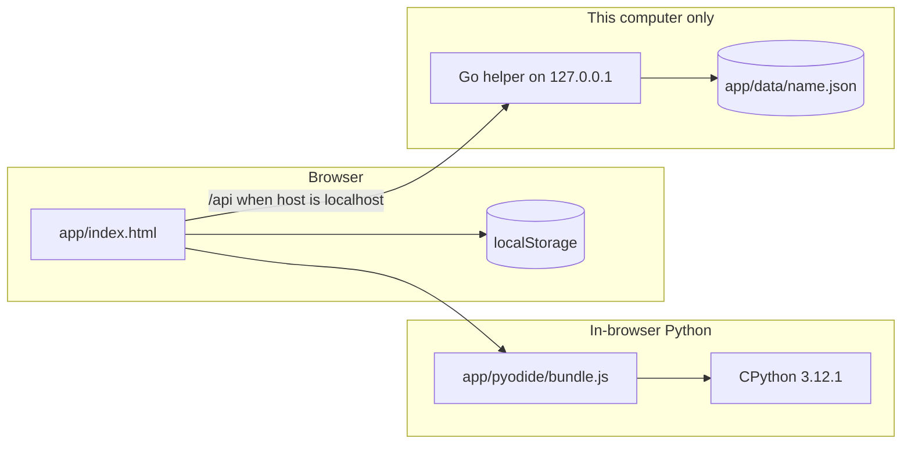

# Architecture

Py Dojo is a static page, an embedded Python interpreter, and an optional program that writes progress to disk. Nothing in the default path phones home.



| Layer | Technology | Responsibility |
|---|---|---|
| Page | HTML, CSS, JavaScript in `app/index.html` | Belts, lessons, quiz, glossary, error encyclopedia, diagrams, profiles, theme |
| Python | Pyodide 0.26.4, CPython 3.12.1, WebAssembly | Runs playground code in a Web Worker. A run is stopped after 5 seconds. |
| Helper | Go 1.21, standard library only (`server/main.go`) | Serves the app folder on `127.0.0.1` and reads and writes progress JSON |
| Progress | JSON | Always in `localStorage`. Also `app/data/<profile>.json` when the helper is the server. |
| Content tools | Python 3 and Node.js in `tools/content-src/` | Generate and check lessons, errors, glossary entries, and exercises |
| Public site | GitHub Pages | The `app/` directory. No helper, so progress stays in the browser. |

## The page

`app/index.html` is the product. Asset URLs inside it are relative (`pyodide/bundle.js`), so the same file works at the root of a local server and at `https://bronxtj.github.io/py-dojo/`.

The page decides it is talking to the helper with:

```text
protocol is http AND hostname is localhost or 127.0.0.1
```

GitHub Pages is `https` on `bronxtj.github.io`, so that test is false. The page does not call `/api/...` there. Opening `index.html` as a `file://` URL fails the test too.

## Playground

The playground loads `pyodide/bundle.js`, which defines `window.PYODIDE_FILES`. Those bytes are the unmodified Pyodide 0.26.4 core (see [THIRD_PARTY_NOTICES.md](../THIRD_PARTY_NOTICES.md)). A Web Worker boots Pyodide from that copy. The status line then says the offline copy is in use.

If the script fails to load, the worker requests `https://cdn.jsdelivr.net/pyodide/v0.26.4/full/` instead, and the status line says the copy came from the internet. That is the only network fetch in the app. It is not analytics. With the bundle present, a normal visit does not make it.

Checked code is compared to the expected output after trimming trailing spaces. Some tasks also require the source to contain an f-string. Hints are revealed one at a time. The solution button stays disabled until Check has been used at least once.

The embedded runtime is the standard library. GeoPandas, Shapely, rasterio, NumPy, and the other libraries named on the Master belt are not installed.

## The helper

`server/main.go` is the program the Start files launch. Release builds place it in `bin/` next to `index.html`. The binary finds the app directory as the parent of its own directory, unless `PYDOJO_DIR` is set. `PYDOJO_NO_BROWSER=1` skips opening a browser.

It binds `127.0.0.1` and tries port 8473, then the next ports through 8482. Each request must come from loopback and must use a `Host` of `localhost:<port>` or `127.0.0.1:<port>`. A foreign `Origin` is rejected.

| Route | Behaviour |
|---|---|
| `GET /api/load?profile=` | Returns that profile's JSON, or `null` if the file is missing |
| `POST /api/save?profile=` | Writes the body if it is valid JSON of at most 1 MiB. Write is to a temporary file, then a rename. |
| `GET /api/profiles` | Lists `data/*.json` names |
| `GET /` | Serves the app folder. Paths under `/data/` and `/bin/` are not served. |

Profile names must match `^[A-Za-z0-9 _-]{1,32}$`. A space in the name becomes an underscore in the filename. There is no default of writing outside `data/`.

## Progress

<a id="progress"></a>

Every change is written to `localStorage` under `pydojo-v1`, or `pydojo-v1:<name>` when the profile is not `default`. The profile name itself is `pydojo-profile`. The theme is `pydojo-theme`.

When the helper is connected, the page also posts the same JSON to `/api/save`. On load, the copy with the newer `updatedAt` wins.

| How you opened it | Browser storage | `data/<profile>.json` |
|---|---|---|
| Start file, helper running | Yes | Yes |
| GitHub Pages | Yes | No |
| `index.html` as a file, or `python -m http.server` | Yes | No |

Export downloads the current JSON. Import replaces it when the file is accepted, and the helper will write that copy through on the next save if it is running.

The home card that says "White Belt" and "Level 1 · Grasshopper" is the starting presentation in the HTML. The belt map, the XP bar, and the glossary filters follow the saved `belt` and XP fields.

## Accessibility

<a id="accessibility"></a>

The interface is built toward WCAG AA. That is an intention, not a formal audit.

- Visible keyboard focus, including the playground textarea.
- Controls use a 44 pixel minimum size.
- Tabs, the belt group, the progress bar, and dialogs expose roles and names.
- Icon-only meaning is paired with text. The save line is a polite live region.
- `prefers-reduced-motion: reduce` removes animation, including the celebration layer.
- The theme sets `color-scheme`, and both themes use the same focus and status colours defined in the page.

## What is deliberately absent

No accounts, no cookies for tracking, no analytics script, and no sync server. Moving progress between machines is an exported JSON file.
