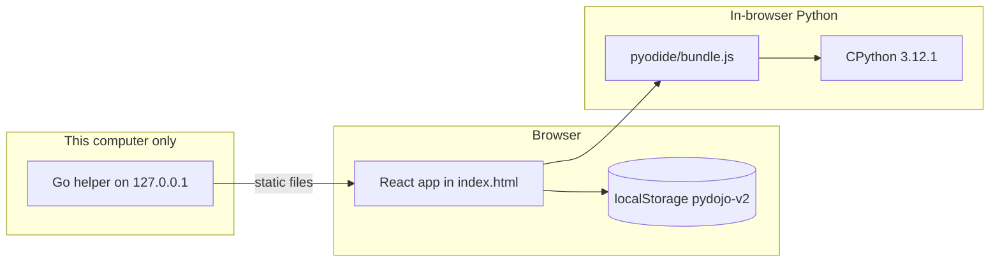

# Architecture

Py Dojo is a React app, an embedded Python interpreter, and an optional program that serves the files on this computer. The page does not phone home.

| Layer | Technology | Responsibility |
|---|---|---|
| App | React 18 and TypeScript in `web/src` | Home, the seven lesson stages, review, practice, glossary, error encyclopedia, theme |
| Build | Vite 5, `base: "./"`, `vite-plugin-singlefile` | One self-contained `index.html`. The worker is inlined. `scripts/copy-pyodide.mjs` places `app/pyodide/` next to that file. |
| Router | Hash routes in `web/src/router.ts` | `#/`, `#/lesson/:id/:stage`, `#/errors`, `#/glossary`, `#/review`, `#/practice`. Works at `/py-dojo/` without server rewrites. |
| Python | Pyodide 0.26.4, CPython 3.12.1, WebAssembly | `web/src/py/engine.ts` loads `pyodide/bundle.js` with a script tag, then boots an inline worker. A run is stopped after 4 seconds. |
| Helper | Go 1.21, standard library only (`server/main.go`) | Serves the folder on `127.0.0.1`. Implements `/api/load`, `/api/save`, and `/api/profiles`. The React UI does not call them. |
| Progress | JSON | `localStorage` key `pydojo-v2`. Export and import on the home screen. |
| Content tools | `web/scripts/gen-content.py` and `tools/content-src/` | Regenerate typed modules. The app reads `web/src/content`, not the JSON files. |
| Public site | GitHub Pages | The Vite `dist/` directory, including `pyodide/bundle.js` and `.nojekyll`. |

## The app

Source lives in `web/`. Production output is a single `index.html` plus the `pyodide/` directory. Relative URLs (`pyodide/bundle.js`, and hashed routes) are what make the same build work from a file open, from `localhost`, and from `https://bronxtj.github.io/py-dojo/`.

Screens:

| Route | Module |
|---|---|
| `#/` | `web/src/screens/Home.tsx` |
| `#/lesson/:id/:stage` | `web/src/screens/LessonScreen.tsx` and `web/src/components/stages/` |
| `#/errors` | `web/src/screens/Errors.tsx` |
| `#/glossary` | `web/src/screens/Glossary.tsx` |
| `#/review` | `web/src/screens/Review.tsx` |
| `#/practice` | `web/src/screens/Practice.tsx` |

The Living Lanka scene is `web/src/components/scene/`. Its outline is `SL_PATH` in `web/src/geo.ts`.

## Playground

`loadEngine` injects `pyodide/bundle.js`. That script defines `window.PYODIDE_FILES` with the unmodified Pyodide 0.26.4 core (see [THIRD_PARTY_NOTICES.md](../THIRD_PARTY_NOTICES.md)). The worker boots from those bytes. The status line then includes `ready`.

If the script fails to load, the status line says the files are missing. There is no CDN fallback.

Checked code is compared to the expected output after trimming. Some tasks also require the source to match a pattern (an f-string, for example). Hints are revealed one at a time.

The embedded runtime is the standard library. GeoPandas, Shapely, rasterio, NumPy, and the other libraries named on the Master belt are not installed.

`TIMEOUT_MS` in `web/src/py/engine.ts` is 4000. The worker is terminated and started again.

## The helper

`server/main.go` is the program the Start files launch. Release builds place the four binaries in `bin/` next to `index.html`. The binary finds the app directory as the parent of its own directory, unless `PYDOJO_DIR` is set. `PYDOJO_NO_BROWSER=1` skips opening a browser.

It binds `127.0.0.1` and tries port 8473, then the next ports through 8482. Each request must come from loopback and must use a `Host` of `localhost:<port>` or `127.0.0.1:<port>`. A foreign `Origin` is rejected.

| Route | Behaviour |
|---|---|
| `GET /api/load?profile=` | Returns that profile's JSON, or `null` if the file is missing |
| `POST /api/save?profile=` | Writes the body if it is valid JSON of at most 1 MiB. Write is to a temporary file, then a rename. |
| `GET /api/profiles` | Lists `data/*.json` names |
| `GET /` | Serves the app folder. Paths under `/data/` and `/bin/` are not served. |

Profile names must match `^[A-Za-z0-9 _-]{1,32}$`. A space in the name becomes an underscore in the filename.

The React app never calls these routes. They remain so the helper's behaviour stays intact for anything that posts to it. Learner progress for the current UI is the browser copy described below.

## Progress

`web/src/store.ts` keeps one JSON document under `localStorage` key `pydojo-v2`. `sanitize` accepts an object only when `v` is `2` and `xp` and `lessons` have the expected shapes. Export downloads that JSON. Import replaces it when `sanitize` accepts the file, and leaves the current progress alone when it does not.

An older key, `pydojo-proto-l1`, is read once if `pydojo-v2` is empty, and only its XP and theme are carried forward.

Autosave writes on each update. If storage throws, the in-memory copy remains and Export still works.

XP is awarded by `gain` in `web/src/store.ts`. Stage completion uses `completeStage` in `web/src/lessonState.ts`, which pays only the first time that stage is marked done.

| Event | XP | Where |
|---|---:|---|
| Hook finished | 5 | `components/stages/Hook.tsx` |
| Learn finished | 5 | `components/stages/Learn.tsx` |
| Watch finished | 10 if a prediction was scored, otherwise 5 | `components/stages/Watch.tsx` |
| Each new Think step on Try | 3 | `components/stages/Try.tsx` |
| Try task matches | 20 | `components/stages/Try.tsx` |
| Bug squashed | 15 | `components/stages/Fix.tsx` |
| Each correct quiz answer | 10 | `components/stages/Quiz.tsx` |
| Lesson marked complete on Reward | 25 | `components/stages/Reward.tsx` |
| Founder's Challenge approved, first time | 20 | `components/stages/Reward.tsx` |
| First run that stops with a Python error | 5 | `session.tsx` (`errSeen`, once) |
| A correct review card | 5 | `screens/Review.tsx` |
| A solved practice coding card | 10 | `screens/Practice.tsx` |
| A correct practice question | 3 | `screens/Practice.tsx` |

Problem solving (`ps`), critical thinking (`ct`), and creativity (`cr`) each increase with some of those awards and are capped at 10.

Review scheduling uses Leitner boxes. `BOX_DAYS` in `store.ts` is `[0, 1, 3, 7, 14, 30]`.

| How you opened it | Browser storage | `data/<profile>.json` from the UI |
|---|---|---|
| Start file, helper running | Yes | No. The UI does not post to `/api/save`. |
| GitHub Pages | Yes | No |
| `index.html` as a file, or `python -m http.server` | Yes | No |

## Accessibility

The interface is built toward WCAG AA. That is an intention, not a formal audit.

- The acceptance suite tabs through the Watch stage and requires a visible focus ring.
- It requires buttons, links, and the scene controls it selects to be at least 44 by 44 pixels.
- With `prefers-reduced-motion: reduce`, it requires no running animations, and the sample run to finish quickly.
- The theme is `data-theme` on the document element. Both themes are part of the layout pass.

## What is deliberately absent

No accounts, no analytics script, and no sync server. Moving progress between machines is an exported JSON file. No CDN copy of Pyodide.
